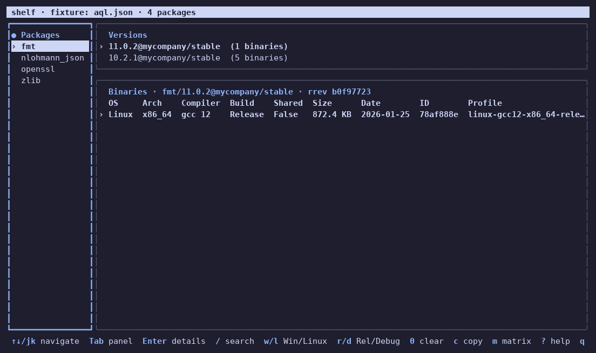

# shelf

A TUI + CLI for browsing Conan 2 packages in JFrog Artifactory from the terminal.
The Artifactory UI shows binaries only as hashes. shelf lays them out in a table by
OS / architecture / compiler / build type, matches binaries to your Conan profiles,
and shows in a matrix which package is missing for which profile.

It runs as a single file on Windows and Linux. No installation, runtime or internet
access is needed.

The interface is in English or Turkish, picked from the system language
(see [Language](#language)).



## Contents

- [Installation](#installation)
- [Quick start](#quick-start)
- [Configuration](#configuration)
- [Interactive interface (TUI)](#interactive-interface-tui)
- [Command line](#command-line)
- [Profile matching](#profile-matching)
- [Where binary information comes from](#where-binary-information-comes-from)
- [Verifying against a real server](#verifying-against-a-real-server)
- [Development](#development)

## Installation

Download the archive for your platform from the [Releases](../../releases) page
(replace `<version>` with e.g. `v0.1.0`):

| Platform | Archive |
| --- | --- |
| Windows x64 | `shelf_<version>_windows_amd64.zip` |
| Linux x64 | `shelf_<version>_linux_amd64.tar.gz` |
| Linux ARM64 | `shelf_<version>_linux_arm64.tar.gz` |

Each archive contains the binary (`shelf` / `shelf.exe`), `README.md` and `LICENSE`.

Linux:

```sh
sha256sum -c SHA256SUMS --ignore-missing     # optional integrity check
tar -xzf shelf_v0.1.0_linux_amd64.tar.gz
sudo install shelf /usr/local/bin/           # or ~/.local/bin
```

Windows: unzip and put `shelf.exe` in a folder on your `PATH`.
To check integrity, compare the output of `Get-FileHash shelf_v0.1.0_windows_amd64.zip`
in PowerShell with `SHA256SUMS`.

With Go installed you can also run:

```sh
go install github.com/hashgesh/shelf/cmd/shelf@latest
```

The release binaries are static and need no Go or other runtime.

On an air-gapped network, copying the file from another machine is enough. shelf
downloads no external dependencies.

## Quick start

```sh
shelf config init     # asks for the Artifactory URL, user, token and repo
shelf                 # opens the interactive interface
shelf list            # packages and their versions
shelf show zlib       # binary table for the newest zlib version
shelf matrix          # package × profile table
```

## Configuration

Settings are read in this order of precedence: **command-line flag > environment variable > config file**.

```sh
shelf config init     # interactive setup (token input is hidden)
shelf config show     # effective settings and the source of each value; token/password masked
```

Config file location:

- Windows: `%APPDATA%\shelf\config.yaml`
- Linux: `~/.config/shelf/config.yaml` (under `$XDG_CONFIG_HOME` if set)
- Another file: `--config <path>` or `SHELF_CONFIG`

Example `config.yaml`:

```yaml
url: https://artifactory.example/artifactory
user: ci-user
token: <access token>
repos:
  - conan-local
profiles_dir: ~/.conan2/profiles
insecure_tls: false
timeout: 30s
# auth: auto | bearer | basic                       (default: auto)
# metadata_source: auto | properties | conaninfo    (default: auto)
```

| Field | Environment variable | Flag | Description |
| --- | --- | --- | --- |
| `url` | `SHELF_URL` | `--url` | Artifactory URL. If only a host is given, `/artifactory` is appended. |
| `user` | `SHELF_USER` | `--user` | User name. |
| `token` | `SHELF_TOKEN` | `--token` | Access token. The flag shows up in the process list; prefer the environment variable. |
| `password` | `SHELF_PASSWORD` | — | Password instead of a token. |
| `repos` | `SHELF_REPOS` (comma-separated) | `--repo` (repeatable) | Conan repos to scan. Default `conan-local`. |
| `profiles_dir` | — | `--profiles-dir` | Conan profile folder. Default `~/.conan2/profiles`, or `$CONAN_HOME/profiles` if `CONAN_HOME` is set. |
| `insecure_tls` | — | `--insecure` | Disables TLS verification for self-signed certificates. |
| `timeout` | — | `--timeout` | Request timeout, e.g. `30s`, `2m`. |
| `auth` | — | — | `auto`: Basic if a password is set, `Authorization: Bearer` if only a token is set. Use `basic` for Basic with user name + token. |
| `metadata_source` | — | — | See [Where binary information comes from](#where-binary-information-comes-from). |

The token and password never appear in any output, error message or `--json` output.
On Linux the config file is written readable only by its owner (`0600`).

`CONAN_HOME` only sets the default for `profiles_dir`. A folder given in the config
file or with `--profiles-dir` takes precedence. `config init` does not write the
default folder to the file, so shelf follows `CONAN_HOME` when it changes.

### Language

shelf shows its interface in Turkish when the system language is Turkish and in
English otherwise. On Linux it reads `LC_ALL`, `LC_MESSAGES` and `LANG`; on Windows
it uses the user's display language. Set `SHELF_LANG=en` or `SHELF_LANG=tr` to force
one. `--json` output is the same in both languages.

## Interactive interface (TUI)

Opens when `shelf` is run without arguments. All data is fetched with a single AQL
query at startup; navigation after that works from memory.

- On a wide terminal the package list is on the left, versions and the binary table
  on the right. Below 100 columns the panels stack vertically.
- Binary table columns: **OS, Arch, Compiler, Build, Shared, Size, Date, Uploader, ID, Profile**.
  As the terminal narrows, secondary columns such as Uploader and Date are hidden first.
- Binaries that match no profile are shown dimmed with a summary label
  (e.g. `Linux_x86_64_gcc12_Release`).

| Key | Action |
| --- | --- |
| `↑` `↓` / `j` `k` | Select row |
| `PgUp` `PgDn`, `g` `G` | Scroll a page, go to top / bottom |
| `Tab`, `Shift+Tab`, `←` `→` | Switch panel |
| `Enter` | Next panel; detail window in the binary table |
| `/` | Live search by package name (`Enter` confirms, `Esc` clears) |
| `w` / `l` | Windows only / Linux only (press again to turn off) |
| `r` / `d` | Release only / Debug only |
| `0` | Clear all filters and search |
| `m` | Matrix view |
| `c` | Copy the `conan install` command for the selected binary |
| `F5` / `R` | Reload data (selection is kept) |
| `?` | Help |
| `q` | Quit |

The bottom bar shows the current shortcuts, active filters and the warning count.

### Detail window

Pressing `Enter` in the binary table shows the full package ID, package and recipe
revision, Artifactory path, all settings and options, the matching profile(s) and a
ready-to-use `conan install` command.

The command pins the recipe revision and uses the matching profile with `-pr:h`
(with no match, each setting is passed with `-s`). The binary's options are added with `-o`:

```sh
conan install --requires="zlib/1.3.1#cc2ab941..." -pr:h linux-gcc12-x86_64-release -o "zlib/*:fPIC=True" -o "zlib/*:shared=False"
```

The command has no Conan remote name (`-r`), because the remote name is each client's own setting.

Quoting: arguments containing characters such as `*`, `#` or spaces are wrapped in
double quotes (valid in bash, cmd and PowerShell). If the value contains `$`, `` ` ``,
`"`, `\` or `!`, single quotes are used; that form works in bash and PowerShell but not in cmd.

**Copy to clipboard (`c`)**: on Windows the system clipboard is used. On Linux,
`wl-copy`, `xclip` and `xsel` are tried in order. If none is available (e.g. over SSH),
an OSC 52 sequence is sent to the terminal. Terminals that support it (Windows Terminal,
iTerm2, kitty, WezTerm, recent xterm, etc.) put the text on the local clipboard. If
copying fails, the command is shown in the detail window.

### Matrix view

Opened with `m`: rows are the newest versions of packages, columns are profiles.

- `✓` at least one binary exists (the number next to it is the count of matching binaries, e.g. shared + static).
- `✗` no binary.
- `?` no match, but there are binaries with unknown settings, so nothing certain can be said.
- `w` `l` `r` `d` filter the columns (profiles), `/` filters the rows (packages).
- Select a profile with `←` `→`; `Enter` opens the selected package filtered to that profile.

## Command line

```text
shelf                                      interactive interface
shelf list [filter]                        packages and their versions
shelf show <name>[/<version>[@user/channel]]   binary table
shelf matrix [package-filter]              package × profile table
shelf config init | show                   configuration
shelf --version                            version information
```

Filters for `show` and `matrix` (case-insensitive, prefix match):

| Flag | Example | Note |
| --- | --- | --- |
| `--os` | `--os win` | matches `Windows` |
| `--arch` | `--arch armv8` | |
| `--compiler` | `--compiler gcc12`, `--compiler msvc` | compiler + version |
| `--build` | `--build rel` | matches `Release` |
| `--profile` | `--profile x86_64-release` | part of the profile name |

For `matrix`, these flags select the columns (profiles). Extra options:
`show --all-revisions` shows all recipe revisions, `matrix --all-versions` shows each version on its own row.

Examples:

```sh
shelf show zlib/1.3.1 --os win --build release
shelf show fmt/10.2.1@mycompany/stable --json
shelf matrix --build Release
shelf list --json | jq '.[].name'
```

Flags valid for all commands:

| Flag | Action |
| --- | --- |
| `--json` | Machine-readable output |
| `--ascii` | `+/-` instead of `✓/✗`, ASCII instead of box drawing (for old Windows consoles) |
| `--no-color` | Disables colors (the `NO_COLOR` environment variable is also supported) |

Colors are turned off automatically when output goes to a file or a pipe.

### Exit codes

| Code | Meaning |
| --- | --- |
| `0` | Success |
| `1` | No results (no matching package/binary) or an unexpected error |
| `2` | Configuration or authentication error (missing URL, 401/403, etc.) |

## Profile matching

Every file under `profiles_dir` is read as a Conan profile (including subfolders,
excluding hidden files), and its `[settings]` section is used.

- `include(...)` lines are resolved; values in the profile override included ones.
- Package-specific settings such as `zlib/*:build_type=Debug` are ignored.
- Jinja template lines (`{{ }}`, ``) are not supported; they are skipped with a warning.

A binary is labeled with a profile if it matches **every** setting in the profile
(case-insensitive). A setting the binary does not have at all counts as compatible:
Conan removes settings a recipe does not use (e.g. `compiler.cppstd` for C libraries)
from the package ID. Header-only packages without settings match every profile.
If several profiles match, the one with the most settings in common is chosen.

Suggested profile naming: `os-compiler-arch-buildtype`, for example
`linux-gcc12-x86_64-release`, `win-msvc194-x64-release`. If no profile matches, a short
summary is shown: `Linux_x86_64_gcc12_Release`.

## Where binary information comes from

A binary's OS / architecture / compiler information can be read from two places:

1. **Artifactory properties** (`conan.settings.*`, `conan.options.*`): returned with
   the AQL query, no extra request needed.
2. **`conaninfo.txt`**: the file Conan writes next to each binary. It is exact but
   needs one download per binary.

The `metadata_source` setting:

| Value | Behavior |
| --- | --- |
| `auto` (default) | Properties are used; `conaninfo.txt` is downloaded for binaries without properties. |
| `properties` | Properties only; if missing, the binary stays "unknown". |
| `conaninfo` | `conaninfo.txt` is read for every binary. |

Downloaded `conaninfo.txt` files are cached in the user cache
(`~/.cache/shelf/conaninfo` on Linux, `%LocalAppData%\shelf\conaninfo` on Windows).
Since the package revision is computed from the content, the cache never goes stale
and is safe to delete.

## Verifying against a real server

Artifactory property names and storage layout can differ between installations.
Two hidden diagnostic commands help check this:

```sh
shelf debug ping                                 # server access + permissions per repo
shelf debug aql --limit 3 --out sample.json      # raw AQL response (contains no token)
shelf debug aql --name conaninfo.txt --limit 3
shelf debug aql --query 'items.find({"repo":"conan-local"}).include("name","path").limit(10)'
```

The default expectations are defined in one place, `internal/conan/layout.go`:

```text
Path layout : {user}/{name}/{version}/{channel}/{rrev}/package/{pkgid}/{prev}
              ("_" when there is no user/channel)
Files       : conan_package.tgz, conaninfo.txt
Recipe      : {user}/{name}/{version}/{channel}/{rrev}/export/conanfile.py
Properties  : conan.package.name, conan.package.version, conan.package.user,
              conan.package.channel, conan.settings.*, conan.options.*
```

If your server differs, changing the constants in that file is enough.
Items that do not fit the path layout are skipped and listed as warnings.

On large repos, AQL results are fetched in pages of 1000 (Artifactory's default result
limit for non-admin users). Paging continues until an empty page arrives, so no item is
skipped even if the server applies the limit to property rows (fewer than 1000 items
per page).

A version's "newest" recipe revision is chosen by the upload date of the recipe file
(`conanfile.py`) to Artifactory. If the recipe file is not found, the date of the
revision's most recently uploaded binary is used.

If the same binary exists in more than one repo (e.g. promoted packages), it is listed once.

## Development

Requirement: Go 1.24+. CGO is not used.

```sh
make build      # bin/shelf
make test
make lint       # requires golangci-lint v2
make release    # linux .tar.gz, windows .zip archives + SHA256SUMS under dist/
```

On Windows the same targets run with `build.ps1`: `.\build.ps1 build|test|lint|release`.

To run with sample data and no server, use the hidden `--fixture` flag:

```sh
go run ./cmd/shelf --fixture testdata/aql.json            # TUI
go run ./cmd/shelf --fixture testdata/aql.json matrix
```

The fixture folder's `profiles/` is used as the profile folder and `files/` as the
`conaninfo.txt` source. Output of `shelf debug aql --out` can also be used directly
as a fixture. The sample data can be regenerated with `testdata/gen_fixture.py`.

Project layout:

```text
cmd/shelf            entry point
internal/config      config file, environment variables, flags
internal/artifactory HTTP client, AQL, fixture source
internal/conan       path layout, model, conaninfo, profile matching, matrix
internal/cli         cobra commands, table and JSON output
internal/tui         Bubble Tea interface
internal/clipboard   clipboard (Win32 API, xclip/xsel/wl-copy, OSC 52)
testdata             sample AQL response, profiles, conaninfo files
```

The change history is in [CHANGELOG.md](CHANGELOG.md) and is generated from commit
messages with [git-cliff](https://git-cliff.org) (`cliff.toml`). Before a new release:

```sh
git cliff --tag v0.2.0 -o CHANGELOG.md     # adds the section for the new version
git commit -am "docs: changelog for v0.2.0"
```

Release notes are generated automatically from the tag's section with the same
configuration. To regenerate the notes of an existing release, run the
`release-notes` workflow from the Actions tab with the tag name.

To publish a release, push a `v*` tag (e.g. `git tag v0.1.0 && git push origin v0.1.0`).
GitHub Actions builds the binaries, packs them (`tools/pack`) and attaches them to the
release. Both `make release` and `build.ps1 release` produce the archives with the same
tool; the Linux binary keeps its executable bit even when packed on Windows. The version
is embedded with `-ldflags` and shown by `shelf --version`.

## License

MIT. See [LICENSE](LICENSE).
