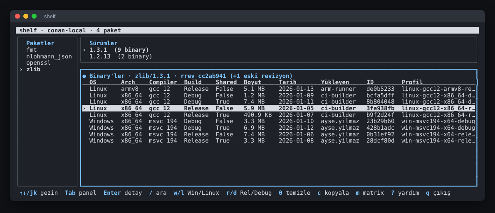
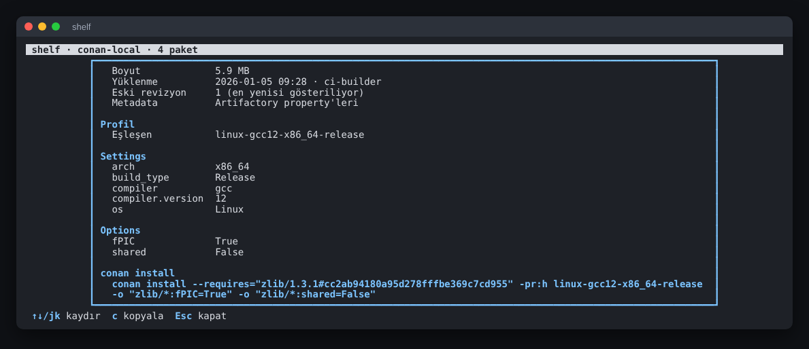
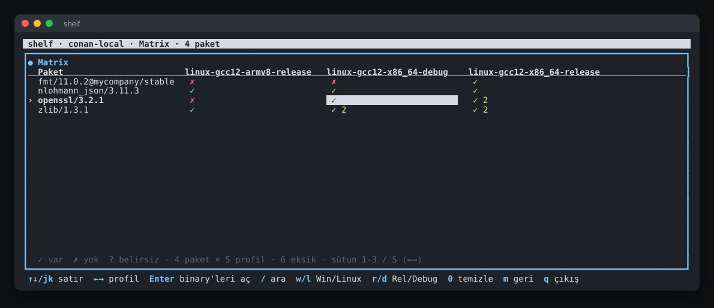

# shelf

JFrog Artifactory'deki Conan 2 paketlerini terminalden okunur şekilde gezmek için
TUI + CLI aracı. Artifactory arayüzünde yalnızca hash olarak görünen binary'lerin
hangi OS / mimari / derleyici / build type için olduğunu tablo halinde gösterir,
binary'leri Conan profillerinizle eşleştirir ve hangi paketin hangi profil için
eksik olduğunu bir matriste gösterir.

Windows ve Linux'ta tek dosya olarak çalışır; kurulum, çalışma zamanı ya da internet
erişimi gerektirmez.



## İçindekiler

- [Kurulum](#kurulum)
- [Hızlı başlangıç](#hızlı-başlangıç)
- [Yapılandırma](#yapılandırma)
- [Etkileşimli arayüz (TUI)](#etkileşimli-arayüz-tui)
- [Komut satırı](#komut-satırı)
- [Profil eşleştirme](#profil-eşleştirme)
- [Binary bilgisinin kaynağı](#binary-bilgisinin-kaynağı)
- [Gerçek ortamda doğrulama](#gerçek-ortamda-doğrulama)
- [Geliştirme](#geliştirme)

## Kurulum

[Releases](../../releases) sayfasından platformunuza uygun arşivi indirin
(`<sürüm>` yerine ör. `v0.1.0`):

| Platform | Arşiv |
| --- | --- |
| Windows x64 | `shelf_<sürüm>_windows_amd64.zip` |
| Linux x64 | `shelf_<sürüm>_linux_amd64.tar.gz` |
| Linux ARM64 | `shelf_<sürüm>_linux_arm64.tar.gz` |

Her arşivde binary (`shelf` / `shelf.exe`), `README.md` ve `LICENSE` bulunur.

Linux:

```sh
sha256sum -c SHA256SUMS --ignore-missing     # isteğe bağlı bütünlük kontrolü
tar -xzf shelf_v0.1.0_linux_amd64.tar.gz
sudo install shelf /usr/local/bin/           # veya ~/.local/bin
```

Windows: zip'i açıp `shelf.exe` dosyasını `PATH` üzerindeki bir klasöre koyun.
Bütünlük kontrolü için PowerShell'de `Get-FileHash shelf_v0.1.0_windows_amd64.zip`
çıktısını `SHA256SUMS` ile karşılaştırabilirsiniz.

Go veya başka bir çalışma zamanı gerekmez; binary'ler statiktir.

Kapalı ağda dosyayı başka bir makineden kopyalamanız yeterlidir; shelf hiçbir
harici bağımlılık indirmez.

## Hızlı başlangıç

```sh
shelf config init     # Artifactory adresi, kullanıcı, token ve repo sorulur
shelf                 # etkileşimli arayüzü açar
shelf list            # paketler ve sürümleri
shelf show zlib       # zlib'in en yeni sürümünün binary tablosu
shelf matrix          # paket × profil tablosu
```

## Yapılandırma

Ayarlar şu öncelik sırasıyla okunur: **komut satırı bayrağı > ortam değişkeni > config dosyası**.

```sh
shelf config init     # etkileşimli kurulum (token girişi ekranda görünmez)
shelf config show     # etkin ayarlar ve her değerin kaynağı; token/şifre maskelenir
```

Config dosyası konumu:

- Windows: `%APPDATA%\shelf\config.yaml`
- Linux: `~/.config/shelf/config.yaml` (`$XDG_CONFIG_HOME` varsa onun altı)
- Başka bir dosya için: `--config <yol>` veya `SHELF_CONFIG`

Örnek `config.yaml`:

```yaml
url: https://artifactory.example/artifactory
user: ci-user
token: <access token>
repos:
  - conan-local
profiles_dir: ~/.conan2/profiles
insecure_tls: false
timeout: 30s
# auth: auto | bearer | basic                       (varsayılan: auto)
# metadata_source: auto | properties | conaninfo    (varsayılan: auto)
```

| Alan | Ortam değişkeni | Bayrak | Açıklama |
| --- | --- | --- | --- |
| `url` | `SHELF_URL` | `--url` | Artifactory adresi. Yalnızca host verilirse `/artifactory` eklenir. |
| `user` | `SHELF_USER` | `--user` | Kullanıcı adı. |
| `token` | `SHELF_TOKEN` | `--token` | Access token. Bayrak süreç listesinde görünür; ortam değişkeni tercih edin. |
| `password` | `SHELF_PASSWORD` | — | Token yerine şifre. |
| `repos` | `SHELF_REPOS` (virgülle) | `--repo` (tekrarlanabilir) | Taranacak Conan repoları. Varsayılan `conan-local`. |
| `profiles_dir` | `CONAN_HOME` (`/profiles` eklenir) | `--profiles-dir` | Conan profil klasörü. Varsayılan `~/.conan2/profiles`. |
| `insecure_tls` | — | `--insecure` | Self-signed sertifikalar için TLS doğrulamasını kapatır. |
| `timeout` | — | `--timeout` | İstek zaman aşımı, örnek `30s`, `2m`. |
| `auth` | — | — | `auto`: şifre varsa Basic, yalnızca token varsa `Authorization: Bearer`. Kullanıcı adı + token ile Basic için `basic`. |
| `metadata_source` | — | — | Bkz. [Binary bilgisinin kaynağı](#binary-bilgisinin-kaynağı). |

Token ve şifre hiçbir çıktıda, hata mesajında veya `--json` çıktısında gösterilmez.
Config dosyası Linux'ta yalnızca sahibinin okuyabileceği izinlerle (`0600`) yazılır.

## Etkileşimli arayüz (TUI)

`shelf` parametresiz çalıştırıldığında açılır. Açılışta tek bir AQL sorgusuyla
tüm veri çekilir; sonraki gezinme bellekten yapılır.

- Geniş terminalde solda paket listesi, sağda sürümler ve binary tablosu yer alır.
  100 sütunun altında paneller alt alta dizilir.
- Binary tablosu: **OS, Arch, Compiler, Build, Shared, Boyut, Tarih, Yükleyen, ID, Profil**.
  Terminal daraldıkça önce Yükleyen ve Tarih gibi ikincil sütunlar gizlenir.
- Hiçbir profille eşleşmeyen binary'ler soluk renkte ve özet etiketle
  (ör. `Linux_x86_64_gcc12_Release`) gösterilir.

| Tuş | İşlev |
| --- | --- |
| `↑` `↓` / `j` `k` | Satır seç |
| `PgUp` `PgDn`, `g` `G` | Sayfa kaydır, başa / sona git |
| `Tab`, `Shift+Tab`, `←` `→` | Panel değiştir |
| `Enter` | Sonraki panel; binary tablosunda detay penceresi |
| `/` | Paket adında anlık arama (`Enter` onaylar, `Esc` siler) |
| `w` / `l` | Sadece Windows / sadece Linux (tekrar basınca kapanır) |
| `r` / `d` | Sadece Release / sadece Debug |
| `0` | Tüm filtreleri ve aramayı temizle |
| `m` | Matrix görünümü |
| `c` | Seçili binary için `conan install` komutunu panoya kopyala |
| `F5` / `R` | Verileri yeniden yükle (seçim korunur) |
| `?` | Yardım |
| `q` | Çıkış |

Alt bar o anki kısayolları, aktif filtreleri ve uyarı sayısını gösterir.

### Detay penceresi

Binary tablosunda `Enter`'a basınca tam package ID, package ve recipe revision,
Artifactory path'i, tüm settings ve options, eşleşen profil(ler) ve hazır bir
`conan install` komutu gösterilir.



Komut, recipe revision'ı sabitler ve eşleşen profili `-pr:h` ile kullanır (eşleşme
yoksa her setting `-s` ile verilir); binary'nin options değerleri `-o` ile eklenir:

```sh
conan install --requires="zlib/1.3.1#cc2ab941..." -pr:h linux-gcc12-x86_64-release -o "zlib/*:fPIC=True" -o "zlib/*:shared=False"
```

Komutta Conan remote adı (`-r`) yoktur, çünkü remote adı her istemcinin kendi ayarıdır.

**Panoya kopyalama (`c`)**: Windows'ta sistem panosu kullanılır. Linux'ta sırasıyla
`wl-copy`, `xclip`, `xsel` denenir; hiçbiri yoksa (ör. SSH oturumu) terminale
OSC 52 dizisi gönderilir. Bunu destekleyen terminaller (Windows Terminal, iTerm2,
kitty, WezTerm, yeni xterm vb.) metni yerel panoya alır. Kopyalama başarısız olursa
komut detay penceresinde gösterilir.

### Matrix görünümü

`m` ile açılır: satırlar paketlerin en yeni sürümleri, sütunlar profillerdir.



- `✓` en az bir binary var (yanındaki sayı eşleşen binary sayısıdır; ör. shared + static).
- `✗` binary yok.
- `?` eşleşen yok ama ayarları bilinmeyen binary'ler var, kesin bir şey söylenemiyor.
- `w` `l` `r` `d` sütunları (profilleri), `/` satırları (paketleri) filtreler.
- `←` `→` ile profil seçin; `Enter` seçili paketi o profile filtrelenmiş olarak açar.

## Komut satırı

```text
shelf                                  etkileşimli arayüz
shelf list [filtre]                    paketler ve sürümleri
shelf show <ad>[/<sürüm>[@user/channel]]   binary tablosu
shelf matrix [paket-filtresi]          paket × profil tablosu
shelf config init | show               yapılandırma
shelf --version                        sürüm bilgisi
```

`show` ve `matrix` filtreleri (büyük/küçük harf duyarsız, önek eşleşmesi):

| Bayrak | Örnek | Not |
| --- | --- | --- |
| `--os` | `--os win` | `Windows` ile eşleşir |
| `--arch` | `--arch armv8` | |
| `--compiler` | `--compiler gcc12`, `--compiler msvc` | derleyici + sürüm |
| `--build` | `--build rel` | `Release` ile eşleşir |
| `--profile` | `--profile x86_64-release` | profil adının bir parçası |

`matrix` komutunda bu bayraklar sütunları (profilleri) seçer. Ek seçenekler:
`show --all-revisions` tüm recipe revision'ları, `matrix --all-versions` her sürümü ayrı satırda gösterir.

Örnekler:

```sh
shelf show zlib/1.3.1 --os win --build release
shelf show fmt/10.2.1@mycompany/stable --json
shelf matrix --build Release
shelf list --json | jq '.[].name'
```

Tüm komutlarda geçerli bayraklar:

| Bayrak | İşlev |
| --- | --- |
| `--json` | Makine tarafından okunabilir çıktı |
| `--ascii` | `✓/✗` yerine `+/-`, kutu çizgileri yerine ASCII (eski Windows konsolu için) |
| `--no-color` | Renkleri kapatır (`NO_COLOR` ortam değişkeni de desteklenir) |

Çıktı bir dosyaya veya pipe'a yönlendirildiğinde renkler otomatik kapanır.

### Çıkış kodları

| Kod | Anlam |
| --- | --- |
| `0` | Başarılı |
| `1` | Sonuç yok (eşleşen paket/binary yok) veya beklenmeyen hata |
| `2` | Yapılandırma veya kimlik doğrulama hatası (eksik URL, 401/403 vb.) |

## Profil eşleştirme

`profiles_dir` altındaki her dosya bir Conan profili olarak okunur (alt klasörler
dahil, gizli dosyalar hariç) ve `[settings]` bölümü kullanılır.

- `include(...)` satırları çözülür; profildeki değerler dahil edilenleri ezer.
- `zlib/*:build_type=Debug` gibi pakete özel ayarlar yok sayılır.
- Jinja şablon satırları (`{{ }}`, ``) desteklenmez; atlanır ve uyarı verilir.

Bir binary, profildeki **her** setting ile eşleşiyorsa (büyük/küçük harf duyarsız)
o profille etiketlenir. Binary'de hiç bulunmayan bir setting uyumlu sayılır: Conan,
tarifin kullanmadığı ayarları (ör. C kütüphanelerinde `compiler.cppstd`) package
ID'den çıkarır. Settings'i olmayan header-only paketler tüm profillere uyar.
Birden fazla profil uyarsa en çok ortak ayarı olan seçilir.

Önerilen profil adı düzeni: `os-derleyici-mimari-buildtype`, örneğin
`linux-gcc12-x86_64-release`, `win-msvc194-x64-release`. Eşleşen profil yoksa kısa
bir özet gösterilir: `Linux_x86_64_gcc12_Release`.

## Binary bilgisinin kaynağı

Binary'lerin OS / mimari / derleyici bilgisi iki yerden okunabilir:

1. **Artifactory property'leri** (`conan.settings.*`, `conan.options.*`): AQL
   sorgusuyla birlikte gelir, ek istek gerekmez.
2. **`conaninfo.txt`**: her binary'nin yanında duran, Conan'ın kendi yazdığı dosya.
   Kesin bilgi içerir ama binary başına bir indirme gerektirir.

`metadata_source` ayarı:

| Değer | Davranış |
| --- | --- |
| `auto` (varsayılan) | Property'ler kullanılır; property'si olmayan binary'ler için `conaninfo.txt` indirilir. |
| `properties` | Yalnızca property'ler; eksikse binary "bilinmiyor" olarak kalır. |
| `conaninfo` | Her binary için `conaninfo.txt` okunur. |

İndirilen `conaninfo.txt` dosyaları kullanıcı önbelleğinde saklanır
(Linux'ta `~/.cache/shelf/conaninfo`, Windows'ta `%LocalAppData%\shelf\conaninfo`).
Package revision içerikten hesaplandığı için önbellek hiçbir zaman eskimez;
silmek güvenlidir.

## Gerçek ortamda doğrulama

Artifactory'nin property adları ve depolama düzeni kuruluma göre farklı olabilir.
İki gizli tanılama komutu bunu kontrol etmeye yarar:

```sh
shelf debug ping                                 # sunucuya erişim + her repo için yetki
shelf debug aql --limit 3 --out ornek.json       # ham AQL yanıtı (token içermez)
shelf debug aql --name conaninfo.txt --limit 3
shelf debug aql --query 'items.find({"repo":"conan-local"}).include("name","path").limit(10)'
```

Varsayılan beklentiler `internal/conan/layout.go` dosyasında tek yerde tanımlıdır:

```text
Path düzeni : {user}/{name}/{version}/{channel}/{rrev}/package/{pkgid}/{prev}
              (user/channel yoksa "_")
Dosyalar    : conan_package.tgz, conaninfo.txt
Property'ler: conan.package.name, conan.package.version, conan.package.user,
              conan.package.channel, conan.settings.*, conan.options.*
```

Gerçek ortam farklıysa yalnızca bu dosyadaki sabitleri değiştirmek yeterlidir.
Path düzenine uymayan öğeler atlanır ve uyarı olarak listelenir.

Büyük repolarda AQL sonuçları 1000'lik sayfalar halinde alınır (Artifactory'nin
yönetici olmayan kullanıcılar için varsayılan sonuç sınırı).

## Geliştirme

Gereksinim: Go 1.24+. CGO kullanılmaz.

```sh
make build      # bin/shelf
make test
make lint       # golangci-lint v2 gerekir
make release    # dist/ altına linux .tar.gz, windows .zip arşivleri + SHA256SUMS
```

Windows'ta aynı hedefler `build.ps1` ile çalışır: `.\build.ps1 build|test|lint|release`.

Sunucu olmadan, örnek verilerle çalıştırmak için gizli `--fixture` bayrağı:

```sh
go run ./cmd/shelf --fixture testdata/aql.json            # TUI
go run ./cmd/shelf --fixture testdata/aql.json matrix
```

Fixture klasöründeki `profiles/` profil klasörü olarak, `files/` ise
`conaninfo.txt` kaynağı olarak kullanılır. `shelf debug aql --out` çıktısı da
doğrudan fixture olarak kullanılabilir. Örnek veriler `testdata/gen_fixture.py`
ile yeniden üretilebilir.

Proje yapısı:

```text
cmd/shelf            giriş noktası
internal/config      config dosyası, ortam değişkenleri, bayraklar
internal/artifactory HTTP istemcisi, AQL, fixture kaynağı
internal/conan       path düzeni, model, conaninfo, profil eşleştirme, matrix
internal/cli         cobra komutları, tablo ve JSON çıktısı
internal/tui         Bubble Tea arayüzü
internal/clipboard   pano (Win32 API, xclip/xsel/wl-copy, OSC 52)
testdata             örnek AQL yanıtı, profiller, conaninfo dosyaları
```

Sürüm yayınlamak için bir `v*` etiketi gönderin (ör. `git tag v0.1.0 && git push origin v0.1.0`);
GitHub Actions binary'leri derleyip arşivler (`tools/pack`) ve release'e ekler.
Arşivleri hem `make release` hem `build.ps1 release` aynı araçla üretir; Linux
binary'si Windows'ta paketlense bile çalıştırma iznini korur. Sürüm bilgisi `-ldflags` ile
gömülür ve `shelf --version` ile görülür.

## Lisans

[LICENSE](LICENSE) dosyasına bakın.
